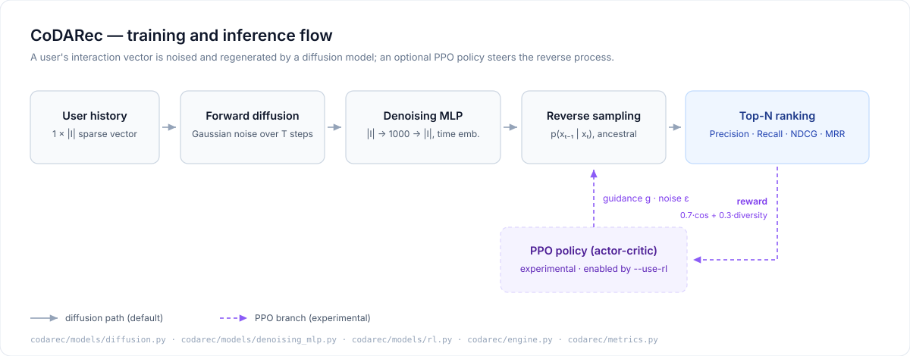

# CoDARec

**Co-evolutionary Diffusion-Augmented Recommendation** — a PyTorch implementation of a
denoising-diffusion recommender whose reverse process is optionally steered by a
PPO policy (the "co-evolutionary" part).

<p align="left">
  <a href="https://github.com/Mxz587/CoDARec/actions/workflows/ci.yml"></a>
</p>

<p align="left">
  <b>Python</b> 3.9+ &nbsp;·&nbsp; <b>PyTorch</b> 1.12+ &nbsp;·&nbsp; <b>License</b> MIT &nbsp;·&nbsp;
  <b>Tests</b> CPU smoke test &nbsp;·&nbsp; <b>Data</b> bundled sample split
</p>

> **Scope.** This repository contains the full CoDARec implementation: the diffusion
> model, the training and evaluation pipelines, the sample data and a CPU smoke test.

<details>
<summary><b>Contents</b></summary>

- [Overview](#overview)
- [Design notes](#design-notes)
- [Repository layout](#repository-layout)
- [Installation](#installation)
- [Data](#data)
- [Quick start](#quick-start)
- [Command line reference](#command-line-reference)
- [Evaluation protocol](#evaluation-protocol)
- [PPO branch (experimental)](#ppo-branch-experimental)
- [Reproducibility notes](#reproducibility-notes)
- [Acknowledgements](#acknowledgements)
- [License](#license)

</details>

---

## Overview

<p align="center">
  
</p>

CoDARec treats implicit-feedback recommendation as a denoising problem: a user's
interaction vector over all items is the signal, and a diffusion process learns to
regenerate it from noise.

| Component | Role | Code |
| --- | --- | --- |
| Forward process | Adds Gaussian noise to a user history over `T` steps | `codarec/models/diffusion.py` |
| Denoising network | MLP `n_items → dims… → n_items`, conditioned on the timestep | `codarec/models/denoising_mlp.py` |
| Reverse sampling | Ancestral sampling produces item scores | `GaussianDiffusion.p_sample` |
| PPO policy *(experimental)* | Chooses guidance strength / exploration noise per step | `codarec/models/rl.py` |
| Evaluation | Full-ranking Precision / Recall / NDCG / MRR | `codarec/metrics.py` |

The diffusion branch is the one used for the reported results; the PPO branch is
gated behind `--use-rl` and is provided as a working research scaffold (see
[PPO branch](#ppo-branch-experimental)).

## Design notes

* **Device agnostic** — every component follows `--device {auto,cpu,cuda}`; no layer,
  loss or sampler hard-codes a CUDA device.
* **Self-contained configuration** — a single `Config` object drives data loading, the
  diffusion schedule, the model, the optimiser and the CLI, and is serialised next to
  every checkpoint as JSON.
* **State-dict checkpoints** — weights plus the resolved config instead of a pickled
  `nn.Module`, so checkpoints stay loadable across PyTorch versions and devices.
* **Bounded memory** — `InteractionDataset` densifies one batch of user rows at a time
  and the PPO environment slices sparse rows, so the full `n_users × n_items` matrix is
  never materialised.
* **Consistent dataset statistics** — `n_users` and `n_items` are derived from all three
  splits, so an item seen only in test is still addressable.
* **Reproducible** — one seed argument drives Python/NumPy/PyTorch/CUDA and the
  DataLoader workers, and model selection uses validation `recall@20` with early
  stopping.

## Repository layout

```
CoDARec/
├── train.py                     # training entry point
├── evaluate.py                  # checkpoint evaluation entry point
├── codarec/                     # importable package
│   ├── config.py                # Config dataclass, CLI, dataset presets
│   ├── utils.py                 # seeding, device resolution, logger
│   ├── metrics.py               # Precision/Recall/NDCG/MRR
│   ├── engine.py                # training loop + full-ranking evaluation
│   ├── checkpoint.py            # state_dict save/load with embedded config
│   ├── data/dataset.py          # .npy loading, sparse interaction matrices
│   └── models/
│       ├── denoising_mlp.py     # reverse-diffusion network
│       ├── diffusion.py         # Gaussian diffusion (training + sampling)
│       └── rl.py                # PPO actor-critic over the denoising chain
├── data/sample_dataset/         # released sample split + item embeddings
├── docs/architecture.svg        # architecture diagram used in this README
├── tests/smoke_test.py          # fast CPU-only self-check
└── checkpoints/                 # written at runtime (git-ignored)
```

## Installation

```bash
git clone https://github.com/Mxz587/CoDARec.git
cd CoDARec
conda create -n codarec python=3.10 -y
conda activate codarec

# PyTorch first — pick the wheel that matches your CUDA runtime (or CPU):
pip install torch --index-url https://download.pytorch.org/whl/cu121

pip install -r requirements.txt
```

`requirements.txt` only pins the science stack (`numpy`, `scipy`, `torch`); everything
else uses the standard library.

## Data

Splits are NumPy arrays, one row per interaction:

| File | Shape | Dtype | Meaning |
| --- | --- | --- | --- |
| `train_list.npy` | `(N, 2)` | `int64` | `(user_id, item_id)` training pairs |
| `valid_list.npy` | `(N, 2)` | `int64` | validation ground truth |
| `test_list.npy` | `(N, 2)` | `int64` | test ground truth |
| `item_emb.npy` | `(n_items, 64)` | `float32` | item embeddings (used by the PPO reward) |

Bundled sample dataset (`data/sample_dataset`, loaded with `--keep-first-half`, the
default):

| Statistic | Value |
| --- | --- |
| Users | 20,263 |
| Items | 34,395 |
| Training interactions | 507,243 |
| Validation / test interactions | 123,338 / 70,787 |
| Training density | 0.0728 % |
| Mean training interactions per user | 25.0 |
| Item embeddings | 34,395 × 64 |

> **Why "first half"?** Each released `.npy` file concatenates two consecutive user
> blocks (users `0–20262`, then `20262–54573`). The reference experiments only use the
> first block, so the loader keeps it by default. Pass `--no-keep-first-half` to train
> on all 54,574 users — item embeddings cover both blocks.

To use your own data, drop the four files into `data/<your_dataset>/` and run with
`--dataset <your_dataset>`. Item and user ids must be contiguous integers starting at
0; `n_items` is derived from the files, and `item_emb.npy` is optional unless you use
`--use-rl`.

See [`data/sample_dataset/README.md`](data/sample_dataset/README.md) for checksums.

## Quick start

```bash
# 1) Self-check on synthetic data — no downloads, CPU only, a few seconds
python tests/smoke_test.py

# 2) Train on the bundled sample dataset (preset = dataset-specific noise schedule)
python train.py --preset sample_dataset --batch-size 400 --lr 1e-5 --device cuda

# 3) Evaluate the best checkpoint
python evaluate.py --checkpoint checkpoints/sample_dataset_lr1e-05_bs400_dims1000_emb10_x0_steps5_scale0.01_codarec.pth
```

Artifacts written per run:

```
checkpoints/<dataset>_lr…_bs…_dims…_emb…_x0_steps…_scale….pth   # best weights + config
checkpoints/<same-stem>_config.json                             # human-readable config
logs/codarec.log                                                # full training log
```

## Command line reference

Run `python train.py --help` for the full list. The most relevant flags:

| Flag | Default | Description |
| --- | --- | --- |
| `--data-root` / `--dataset` | `data` / `sample_dataset` | data location |
| `--preset` | – | diffusion preset: `sample_dataset`, `amazon-book_clean`, `ml-1m_clean`, `amazon-book_noisy`, `sample_noisy`, `ml-1m_noisy` |
| `--device` | `auto` | `auto` / `cpu` / `cuda` |
| `--batch-size`, `--lr`, `--weight-decay` | `40`, `1e-4`, `0.0` | optimisation |
| `--epochs`, `--eval-every`, `--patience` | `1000`, `5`, `20` | schedule and early stopping |
| `--dims` | `[1000]` | hidden sizes of the denoising MLP |
| `--emb-size` | `10` | timestep embedding size |
| `--steps` | `100` | diffusion steps `T` |
| `--noise-scale`, `--noise-min`, `--noise-max` | `0.1`, `1e-4`, `0.02` | linear variance schedule |
| `--reweight` / `--no-reweight` | enabled | importance weighting of the diffusion loss |
| `--sampling-steps`, `--sampling-noise` | `0`, disabled | reverse-sampling start point |
| `--topn`, `--select-metric` | `[10,20,50,100]`, `recall@20` | evaluation and model selection |
| `--test-with-valid` | disabled | also mask validation items when testing |
| `--use-rl` | disabled | score with the PPO denoising policy |
| `--seed` | `1` | global seed |

Presets fix only the dataset-dependent diffusion noise settings; any explicit flag
overrides them.

## Evaluation protocol

* **Full ranking** — for each user, every item is scored; the items in the user's
  history (plus validation items when `--test-with-valid`) are masked to `-inf`.
* **Metrics** — Precision, Recall, NDCG and MRR at cut-offs `{10, 20, 50, 100}`.
* **Model selection** — the epoch with the best validation `recall@20` is kept;
  training stops after `--patience 20` epochs without improvement.

## PPO branch (experimental)

`--use-rl` swaps ancestral sampling for a learned policy:

1. an episode starts from the noisy history of a batch of users;
2. the actor emits `[guidance_scale, exploration_noise]` per step;
3. the state is updated as
   `s ← g · model(s, t) + (1 − g) · s + ε · noise`;
4. on the final step the reward is
   `0.7 · cosine(final_state, history) + 0.3 · diversity(top-10 item embeddings)`.

`RecommendationEnv`, `PPOAgent`, `rollout()` and `PPOAgent.update()` are implemented and
unit-checked in `tests/smoke_test.py`, but the policy is **not** trained by `train.py`
and is therefore untrained when used for scoring. Treat it as an extension point rather
than a reproducible result; the default path (`--no-use-rl`) is what `evaluate.py`
scores.

## Reproducibility notes

* Every checkpoint embeds its full `Config`; `evaluate.py` always rebuilds the diffusion
  process from the checkpoint, so train-time and test-time schedules cannot drift apart.
* `set_seed` seeds Python, NumPy, PyTorch, CUDA and the DataLoader workers.
* The diffusion loss history used by the importance sampler lives on the device and is
  reset per run.

## Acknowledgements

The diffusion core implements the standard DDPM formulation adapted to implicit feedback
(noise schedules, importance-sampled losses, ancestral sampling), and the PPO scaffold
follows the clipped-objective actor-critic algorithm. The bundled sample split is
released with this repository so that the pipeline can be reproduced end to end.

## License

Released under the [MIT License](LICENSE).
